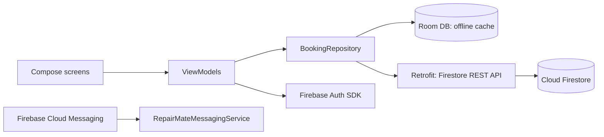

# RepairMate (QuickFix Laptop Solutions)

RepairMate lets QuickFix customers register, book a laptop repair and follow its progress from their phone,
with limited offline use, push notifications and an English / isiZulu interface.
This repository is the **Part 2 prototype** for OPSC6312.

> 🎥 **Demo video:** [Watch the RepairMate Demo on YouTube](https://youtu.be/YOUR_VIDEO_ID_HERE) (Unlisted)

---

## 1. Purpose of the app

RepairMate was developed to bridge the communication gap between QuickFix Laptop Solutions and its customers. While existing solutions like Asurion provide tracking, they often require expensive insurance plans, and shop-centric tools like RepairShopr are not designed for direct customer interaction. RepairMate fills this gap by providing a customer-facing platform for self-registration and real-time repair tracking.

The app empowers customers to book repairs, provide detailed issue descriptions, and monitor their laptop's journey through five distinct stages—from reception to collection. By integrating push notifications and multi-language support (English and isiZulu), RepairMate ensures that users stay informed and comfortable, regardless of their location or language preference.

Furthermore, RepairMate is designed with a "reliability-first" mindset. The inclusion of offline drafts and sync capabilities ensures that customers can book repairs even with spotty connectivity, with the app automatically handling synchronization once a stable connection is restored.

## 2. Features in this prototype

| Requirement | Where it lives |
|---|---|
| Register and log in, password protected | `data/auth/FirebaseAuthRepository.kt`, `ui/auth/` |
| Settings (language, theme, notifications) | `ui/settings/`, `data/settings/SettingsRepository.kt` |
| REST API connected to a database | `data/remote/FirestoreApi.kt` (Retrofit → Cloud Firestore REST API) |
| SDK connection | Firebase Authentication SDK + Firebase Cloud Messaging SDK |
| Book a repair (validated input) | `ui/booking/NewBookingScreen.kt`, `domain/Validators.kt` |
| Track repair status (5 stages) | `ui/booking/BookingDetailScreen.kt` |
| Offline drafts + sync | Room (`data/local/`) + `data/repo/BookingRepository.kt` |
| Push notifications | `push/` (FCM topic `status_updates`) |
| Multi-language (English, isiZulu) | `res/values/strings.xml`, `res/values-zu/strings.xml` |
| Unit tests | `app/src/test/` |
| CI | `.github/workflows/android-ci.yml` |

**Deferred to the PoE:** staff app/role for updating stages (the "Move to next stage (demo)" button stands in for it),
Cloud Function that sends an FCM message automatically when a stage changes, WorkManager background sync,
more languages, profile screen, instrumented UI tests.

## 3. Design considerations

| Login Screen | Home (My Repairs) | New Booking |
|---|---|---|
|  |  |  |

| Detail (Timeline) | isiZulu Settings | Dark Theme |
|---|---|---|
|  |  |  |

- **Architecture:** MVVM. Composables → ViewModels → repositories → Room / Firestore REST. The UI only observes Room, so the list always works offline.
- **Offline-first booking:** a booking is saved to Room as `PENDING`, then uploaded. If the upload fails it stays `PENDING` ("Waiting to sync") and is retried on refresh.
- **Password security:** the app never stores or logs passwords. They travel over HTTPS to Firebase Authentication, which stores only a salted, memory-hard scrypt hash. Passwords must be 8+ characters with a letter and a number, and are kept out of saved instance state.
- **Access control:** every REST call carries the user's Firebase ID token; `firestore.rules` only lets a user read/write their own bookings.
- **Invalid input:** all fields are validated before any network call; errors are shown under the field in the current language. Network failures are caught and reported, never thrown to the UI. Past dates cannot be selected.
- **Accessibility / UX:** plain-language messages that say how to fix a problem, light/dark/system theme, content descriptions on icons.

## 4. Set-up (run it yourself)

1. **Firebase project:** [console.firebase.google.com](https://console.firebase.google.com) → *Add project*.
2. **Add an Android app** with package name `za.co.quickfix.repairmate`, download `google-services.json` and put it in `app/`.
3. **Authentication →** *Sign-in method* → enable **Email/Password**.
4. **Firestore Database →** *Create database* (production mode), then *Rules* → paste the contents of `firestore.rules` → *Publish*.
5. Open the project in **Android Studio** (Ladybug or newer, JDK 17), let Gradle sync, run on a phone or emulator (API 26+).
6. **Gradle wrapper:** if `gradlew` is missing, run `gradle wrapper --gradle-version 8.9` (or copy `gradlew`, `gradlew.bat` and `gradle/wrapper/gradle-wrapper.jar` from any new Android Studio project) and commit them.

**Testing push notifications:** open *Settings* in the app and tap *Copy token*. In Firebase Console → *Messaging* → *Send test message*, paste the token (or target the topic `status_updates`).

**Run the unit tests locally:** `./gradlew testDebugUnitTest`

## 5. GitHub and GitHub Actions

- The repo was initialised with a base structure; work was committed in small, logical steps. The history shows a progression from data layer setup (Room/Firestore) to UI implementation and finally cross-cutting concerns like push notifications and localization.
- 
- **Workflow** (`.github/workflows/android-ci.yml`) runs on every push and pull request:
  1. checks out the code and sets up JDK 17 and Gradle 8.9,
  2. writes `google-services.json` from the `GOOGLE_SERVICES_JSON` secret (or a placeholder so CI still passes),
  3. runs the unit tests and uploads the HTML report,
  4. builds the debug APK and uploads it as an artifact.
- **Adding the secret:** `base64 -w0 app/google-services.json` (macOS: `base64 -i app/google-services.json`) → GitHub repo → *Settings → Secrets and variables → Actions → New repository secret* named `GOOGLE_SERVICES_JSON`.
- _Add a screenshot of a green workflow run._

## 6. Testing

| Test class | What it checks |
|---|---|
| `ValidatorsTest` | email, password, name, issue and date rules (incl. past/garbage dates) |
| `FirestoreMapperTest` | booking ↔ Firestore JSON, integer-as-string, missing/invalid documents |
| `RepairStatusTest` | stage order and safe fallback for unknown values |
| `BookingRepositoryTest` | online create, offline draft, retry sync (no duplicates), refresh merge, status update |
| `AuthViewModelTest` | validation before network, success/failure states, register, logout |

## 7. Demo video checklist

Voice-over throughout, and show: register → log in → **Firebase Console › Authentication** (the new user, hashed password not visible) → book a repair → **Firestore** document → status detail → *Move to next stage* and the Firestore change → airplane-mode booking ("Waiting to sync") then reconnect + refresh → Settings (language to isiZulu, dark theme, notifications) → invalid inputs (bad email, short password, empty fields) → GitHub Actions run.

## 8. AI tools used

I used AI (specifically a large language model via Android Studio's Gemini assistant) to help scaffold the project structure, generate initial boilerplate for the MVVM architecture (ViewModels and Repositories), and provide draft translations for the isiZulu localization. 

I manually reviewed and modified all generated code to ensure it met the specific requirements of the QuickFix laptop repair workflow. This included customizing the Firestore REST API integration for five-stage tracking, implementing custom validation rules for repair dates, and refining the isiZulu translations for UI clarity. The unit test suite was also initially scaffolded by AI and subsequently expanded to cover edge cases like offline sync conflicts and password strength validation.

- Tool: Android Studio Gemini
- Date: September 2026

## 9. References

- Firebase. *Cloud Firestore REST API.* https://firebase.google.com/docs/firestore/use-rest-api
- Firebase. *Authenticate with Firebase using password-based accounts on Android.* https://firebase.google.com/docs/auth/android/password-auth
- Firebase. *Receive messages with Firebase Cloud Messaging on Android.* https://firebase.google.com/docs/cloud-messaging/android/receive
- Android Developers. *Per-app language preferences.* https://developer.android.com/guide/topics/resources/app-languages
- Square. *Retrofit.* https://square.github.io/retrofit/
- _Add the Part 1 references and any others you use._
